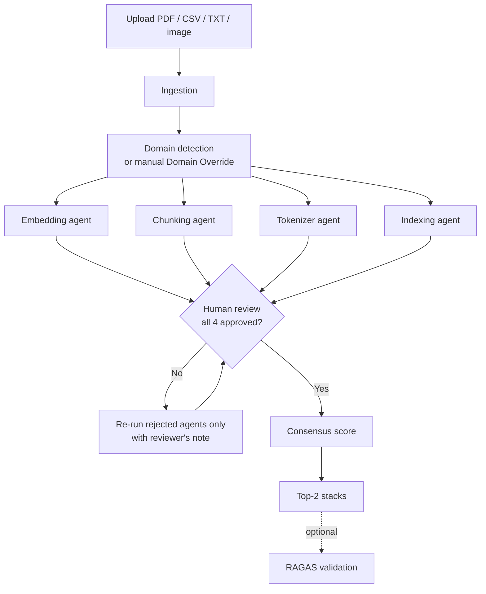

# RAG Architect — Design Document

## 1. What problem this solves

Building a RAG system means choosing four things: an **embedding model**, a **chunking strategy**, a **tokenizer** and an **index**. The best choice depends on the documents. Most teams guess.

RAG Architect looks at a user's own documents, has four specialist LLM agents each score three options, asks a human to approve or reject each agent, and returns the **Top-2 full stacks**. An optional RAGAS check then measures the embedding and chunking picks on the same document.

It is an **advisory tool**: it recommends, a human decides, and it is honest about what is measured versus estimated (§6).

## 2. How it works



1. **Ingest.** PDFs (PyMuPDF), CSVs (summarised as shape, columns and 10 sample rows), text files, and images (OCR with Tesseract). The text sent to the LLM is capped at 1,500 characters per file and 6,000 overall.
2. **Detect domain.** One LLM call picks one of 10 domains (Healthcare, Banking, Insurance, Manufacturing, Retail, Telecom, Legal, Education, Pharma, Aerospace). The user can override it, which skips this call.
3. **Four agents run in parallel.** Each scores its three fixed candidates on retrieval, latency and accuracy (0–1):

| Agent | Candidates |
|---|---|
| Embedding | BGE Large, all-mpnet-base-v2, nomic-embed-text |
| Chunking | Fixed (512/100), Semantic (0.80), Recursive (1024/200) |
| Tokenizer | tiktoken, SentencePiece, WordPiece |
| Indexing | FAISS IVF, HNSW, Chroma |

4. **Human review.** The reviewer approves or rejects each agent. Nothing is final until all four are approved.
5. **Consensus.** Every combination (3 × 3 × 3 × 3 = **81**) gets a score, and the best two are returned.

## 3. Key design decisions

### Parallel agents with LangGraph
The graph is `domain_detect → 4 agents → join`. LangGraph runs the four agent nodes at the same time, so the cost is about the slowest agent, not the sum. The parallelism comes from the graph edges, so the agent code has no threading in it.

### Human-in-the-loop gate
No recommendation is produced until all four agents are approved. When one is rejected, **only that agent re-runs**, on the same document and domain, with the reviewer's note added to its prompt. This was chosen over two alternatives:

- *Try the second-ranked candidate:* ignores why the reviewer rejected it.
- *Blind retry:* random, and gives the reviewer no influence.

Same evidence plus redirected reasoning keeps the run auditable. Re-runs also skip the cache, so a rejected answer is never replayed.

### Reliable LLM calls
Everything goes through one function, `call_llm`:

| Situation | What happens |
|---|---|
| Rate limit, server error, timeout | Retry with exponential backoff (up to 5 tries), honouring `Retry-After` |
| Wait would be too long (for example a daily limit), or model not available | Switch to the other model |
| Bad API key | Fail immediately |
| Reply isn't valid JSON | Ask again (JSON mode is used where the model supports it) |

Replies are also **validated**, not just parsed: names must match the offered options, every option must be scored exactly once, and the top pick must agree with its own scores. If not, the model is asked again with the error message. If an agent still fails, it returns flagged **placeholder 0.5 scores** and the UI warns the reviewer, so one failure never crashes the run. Identical requests are served from a cache, and token, retry and fallback counts are shown in the UI.

### Filtering without more LLM calls
- **Domain Override** is a full re-run, because domain is part of every agent's prompt.
- **Locks** pin Chunking, Tokenizer or Indexing to one candidate and re-rank instantly. All three candidates per category are already scored, so this is pure re-sorting.
- **Embedding is not lockable.** It drives the retrieval estimate most directly, so locking it without re-scoring would show a stale number. Changing it means a full re-run.
- The **Comparison tab** lists all 81 combinations with the same filters, even before approval is finished.

## 4. Scoring

```
final_score = 0.4 × avg(retrieval) + 0.2 × avg(latency) + 0.2 × human approval + 0.2 × avg(accuracy)
```

Averages are over the four chosen candidates. *Human approval* is the fraction of agents approved. Because the gate needs all four, official results always have 1.0 here. Lower values only appear in the Comparison tab before approval.

**Ties** are broken in order by: higher retrieval score, higher human approval, higher latency score, then Embedding name. This makes the same input always give the same ranking.

## 5. Optional RAGAS validation

The agents' scores are LLM opinions. This feature **measures** two of them on the user's own document (needs 300+ words; install with `requirements-eval.txt`):

1. The LLM writes test questions with reference answers from the document.
2. For each Embedding option (chunking fixed), and then each Chunking option (best embedding fixed), the document is chunked, embedded, and the top 3 chunks retrieved per question.
3. RAGAS scores the retrieved chunks for context recall and precision. The **measured score** is their average.
4. The result is compared with the agent's retrieval score, showing whether the agent's top pick matches the measured winner.

It is slow and uses tokens, so it runs only when the user clicks the button. Heavy packages are imported lazily so the normal app starts without them.

## 6. What is measured and what is not

| Score | Source |
|---|---|
| Retrieval (Embedding, Chunking) | LLM estimate; can be measured with RAGAS |
| Retrieval (Tokenizer, Indexing) | LLM estimate only |
| Latency, Accuracy | LLM estimate only |
| Human approval | Real reviewer decisions |

Any report built from this app should say so, and should not present these estimates as measured accuracy.

## 7. Configuration and deployment

Settings come from environment variables or an untracked `.env`. There are no key fields in the UI.

| Variable | Purpose |
|---|---|
| `GROQ_API_KEY` | Required |
| `GROQ_MODEL` | Optional; default `openai/gpt-oss-120b` (other: `openai/gpt-oss-20b`) |
| `LANGCHAIN_API_KEY` / `LANGSMITH_API_KEY`, `LANGCHAIN_TRACING_V2` / `LANGSMITH_TRACING`, `LANGCHAIN_PROJECT` / `LANGSMITH_PROJECT` | Optional LangSmith tracing (default project `agentbench-ai`) |
| `EVAL_TRUST_REMOTE_CODE` | `true` to allow `nomic-embed-text` in the RAGAS check |

**LangSmith vs RAGAS:** LangSmith records what each LLM call did (prompts, latency, tokens). RAGAS checks whether the picks are actually good. They are not interchangeable.

**Hugging Face Spaces checklist**
- Push `app.py`, `agents.py`, `ingestion.py`, `consensus.py`, `evaluation.py`, `requirements.txt`, `packages.txt`, `README.md`.
- Add `GROQ_API_KEY` under **Repository secrets**.
- `packages.txt` must contain `tesseract-ocr`, or OCR returns an error message instead of text.
- The README's `sdk_version` (5.49.1), not `requirements.txt`, decides the Gradio version on Spaces. Older versions crash on `/gradio_api/info`, so check that it returns HTTP 200 after deploy.
- Session state is a single JSON string in `gr.State("")`. Keep it that way; an open dict breaks Gradio's schema generation.
- Because the key lives on the server, **every visitor of a public Space uses your Groq quota**.

## 8. Known gaps

| Gap | Note |
|---|---|
| No hard per-call LLM timeout | Retries exist, but a request that hangs without erroring is not cut off |
| HITL decisions not sent to LangSmith | Would need `create_feedback` per agent per decision |
| No per-agent live progress | The UI shows one spinner; `graph.stream()` would allow per-agent status |
| Tokenizer, Indexing, accuracy and latency scores unmeasured | LLM estimates only |
| Gradio handlers and live network calls untested | The 107 unit tests use fakes |

## 9. Code map

| File | Role |
|---|---|
| `app.py` | Gradio UI and handlers |
| `agents.py` | Graph, domain detection, agents, LLM retry/fallback/cache layer |
| `ingestion.py` | File extraction |
| `consensus.py` | Scoring, tiebreaks, locks, comparison table |
| `evaluation.py` | Optional RAGAS validation |
| `tests/` | 107 unit tests |
| `dataset/` | Sample CSV (Healthcare), TXT (Insurance), PDF (Pharma), PNG (Manufacturing) |
